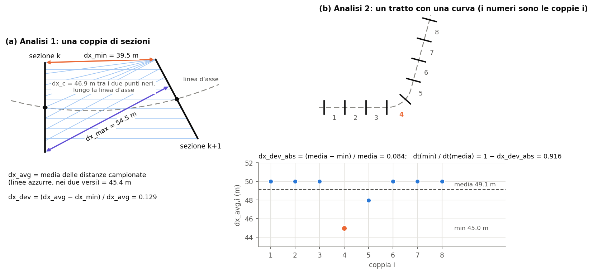
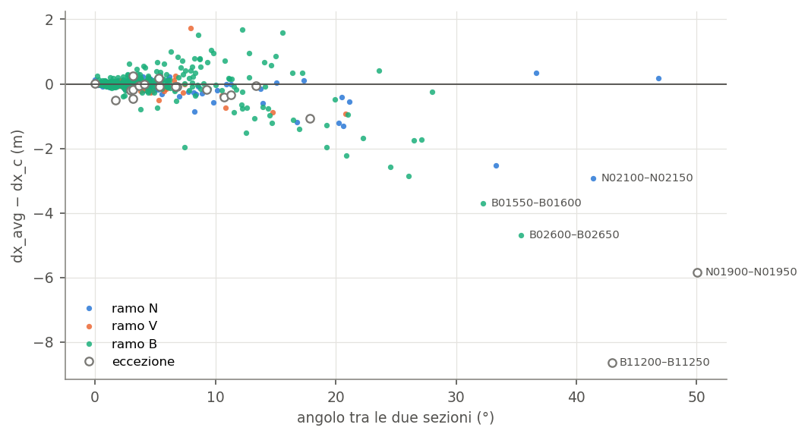
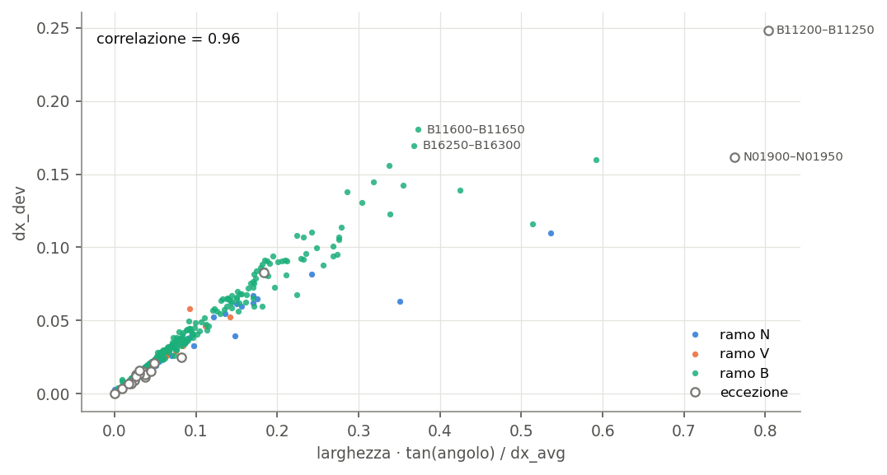
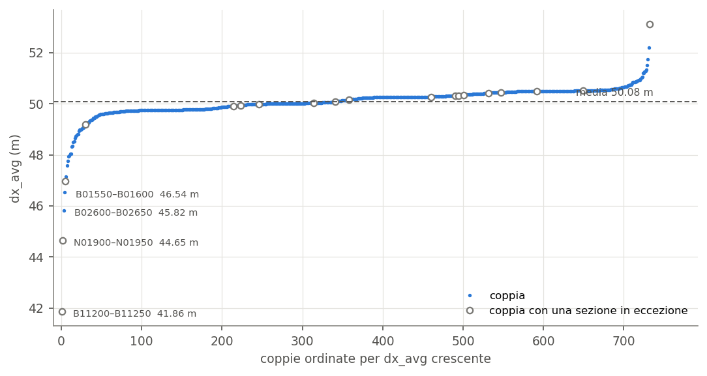

# Analisi statistica del passo tra le sezioni (sezioni a 50 m)

Analisi del 18 novembre 2026, sulle sezioni dopo le modifiche a mano di Borgo; tabelle e figure aggiornate il 19 novembre. Il contesto è nel [registro di lavoro](workflow.md), alla voce "18 novembre 2026, pomeriggio".

* **Script:** `scripts/dx_dev.py` per le tabelle ([scheda](scripts/dx_dev.md)) e `scripts/dx_dev_fig.py` per le figure ([scheda](scripts/dx_dev_fig.md)).
* **Dati di ogni coppia:** [Brenta_dx_dev_50m.csv](Brenta_dx_dev_50m.csv).
* **Figure:** cartella [figures](figures).

## 1. Oggetto

L'analisi riguarda il passo dx tra sezioni consecutive dello stesso ramo, cioè 732 coppie: 320 nel ramo N, 59 nel V e 353 nel B. È svolta su due livelli:

* **Analisi 1, locale:** misura quanto ogni sezione è inclinata rispetto alla successiva (paragrafo 4).
* **Analisi 2, globale:** misura quanto il passo più corto di un ramo, o dell'intero modello, è inferiore al passo medio (paragrafo 5). È questa che conta per un modello 1D: con uno schema esplicito per equazioni iperboliche il passo temporale ammesso dalla condizione CFL, dt ≤ CFL · dx / (|u| + c), lo fissa il dx più piccolo.

Le statistiche sono date due volte:

* **tutte le coppie;**
* **senza eccezioni:** si escludono le 19 coppie che contengono almeno una sezione in eccezione:
  * N01850–N01900, N01900–N01950, N01950–N02000;
  * N15950–N16000, N16000–N16050;
  * le undici coppie da B00000–B00050 a B00500–B00550;
  * B11150–B11200, B11200–B11250, B11250–B11300.

Nelle figure le coppie in eccezione sono disegnate con un cerchio vuoto grigio.

## 2. Grandezze per coppia

Per la coppia i, formata dalle sezioni k e k+1, si calcolano le grandezze della tabella 1. La figura 1a le mostra su una coppia di esempio.

**Tabella 1.** Grandezze calcolate per ogni coppia di sezioni consecutive; sono le colonne del CSV.

| Simbolo | Colonna del CSV | Significato |
|---|---|---|
| dx_avg,i | `dx_avg` | distanza media tra le due sezioni. Ognuna si campiona in 201 punti equidistanti, per ogni punto si misura la distanza dall'altra sezione (il segmento), e si fa la media sui punti di entrambe |
| dx_c,i | `dx_c` | distanza lungo la linea d'asse (`dist_next`) |
| dx_avg,i − dx_c,i | `diff_avg_c` | differenza tra le due misure del passo |
| dx_min,i | `dx_min` | distanza minima tra i due segmenti |
| dx_max,i | `dx_max` | distanza massima tra i punti campionati |
| dx_dev,i | `dx_dev` | (dx_avg,i − dx_min,i) / dx_avg,i, analisi 1 |
| angolo | `ang_gradi` | angolo tra le due sezioni, in gradi |
| larghezza | `larg_m` | lunghezza media delle due sezioni |
| e_i | `e_avg_ramo` | (dx_avg,i − media del ramo) / media del ramo |



*Figura 1. Schema delle due analisi, su una geometria di esempio (non sono sezioni del modello); i valori sono calcolati con lo stesso metodo dello script. (a) Analisi 1: due sezioni consecutive inclinate tra loro. In azzurro una parte delle distanze campionate, la cui media è dx_avg; in arancione dx_min, in viola dx_max. dx_c è misurato lungo la linea d'asse tratteggiata, tra i due punti neri. (b) Analisi 2: un tratto con una curva e una sezione ogni 50 m lungo la linea d'asse. Sotto, la serie dei dx_avg,i: il minimo (in arancione) cade nella curva e fissa il dt; dx_dev_abs confronta il minimo con la media della serie.*

## 3. Il passo lungo i rami

La figura 2 mostra dx_avg di ogni coppia lungo i tre rami, la figura 3 la differenza dx_avg − dx_c. Sull'asse orizzontale c'è la progressiva nominale, ricavata dal nome delle sezioni (indice × 50 m).


*Figura 2. dx_avg di ogni coppia lungo i rami N, V e B, con la media del ramo (tratteggio). Sono indicate le coppie più lontane dalla media.*


*Figura 3. dx_avg − dx_c di ogni coppia lungo i rami. Valori negativi: la distanza media tra le due sezioni è più corta del passo lungo la linea d'asse.*



*Figura 4. dx_avg − dx_c in funzione dell'angolo tra le due sezioni, per ramo. Sono indicate le cinque coppie con la differenza più negativa.*

**Tabella 2.** Statistiche di dx_avg − dx_c (m) per ramo, su tutte le coppie.

| Insieme | Coppie | Media | Media dei valori assoluti | Min | Max | \|dx_avg − dx_c\| < 0.1 m | \|dx_avg − dx_c\| < 0.5 m | < −1 m | > +1 m |
|---|---|---|---|---|---|---|---|---|---|
| N | 320 | −0.066 | 0.094 | −5.85 | +0.34 | 82.8% | 96.9% | 6 | 0 |
| V | 59 | −0.064 | 0.147 | −0.93 | +1.73 | 67.8% | 91.5% | 0 | 1 |
| B | 353 | −0.072 | 0.281 | −8.64 | +1.69 | 58.4% | 85.0% | 18 | 5 |
| **Totale** | 732 | −0.069 | 0.189 | −8.64 | +1.73 | 69.8% | 90.7% | 24 | 6 |

**Come leggere il paragrafo 3**

* **Le due misure coincidono quasi sempre.** dx_avg e dx_c differiscono in media di 0.19 m in valore assoluto, e per il 91% delle coppie di meno di 0.5 m (tabella 2).
* **Dove divergono.** Gli scarti grandi sono quasi tutti negativi e nascono nelle curve strette (figura 4): la correlazione tra la differenza e l'angolo è −0.59. Sotto i 10° di angolo, cioè nel 90% delle coppie, lo scarto non supera 1.95 m; per le 22 coppie sopra i 20° la mediana è −1.71 m.
* **Casi estremi.** B11200–B11250 (−8.64 m) e N01900–N01950 (−5.85 m) sono in eccezione; senza eccezioni il minimo è B02600–B02650 (−4.68 m). Gli scarti positivi sono più piccoli, fino a +1.73 m (V02700–V02750); nel ramo B compaiono soprattutto tra sezioni larghe con un angolo moderato (tabella 4).
* **Ramo B.** È il meno regolare (figura 2 e figura 3), con le zone più disturbate attorno a 1–3 km, a 5 km, a 11 km e a 13–14 km.

## 4. Analisi 1: inclinazione tra sezioni consecutive

**dx_dev,i = (dx_avg,i − dx_min,i) / dx_avg,i**

Vale 0 per due sezioni parallele e cresce quando convergono da un lato (figura 1a).

**Tabella 3.** Statistiche di dx_dev per ramo e in totale, con tutte le coppie e senza eccezioni. Le colonne "> 0.01" … "> 0.10" contano le coppie sopra la soglia; angolo e larghezza sono medie sull'insieme.

| Insieme | Coppie | Media | Mediana | Dev. std | 90° perc. | 95° perc. | 99° perc. | Max | > 0.01 | > 0.02 | > 0.05 | > 0.10 | Angolo medio (°) | Larghezza media (m) |
|---|---|---|---|---|---|---|---|---|---|---|---|---|---|---|
| N, tutte | 320 | 0.0070 | 0.0011 | 0.0160 | 0.0172 | 0.0327 | 0.0664 | 0.1617 | 60 | 25 | 11 | 2 | 2.39 | 20.9 |
| V, tutte | 59 | 0.0120 | 0.0084 | 0.0123 | 0.0267 | 0.0342 | 0.0547 | 0.0580 | 24 | 10 | 2 | 0 | 3.77 | 19.7 |
| B, tutte | 353 | 0.0333 | 0.0203 | 0.0363 | 0.0857 | 0.1026 | 0.1577 | 0.2482 | 245 | 177 | 81 | 19 | 5.00 | 48.0 |
| **Totale, tutte** | 732 | 0.0201 | 0.0079 | 0.0304 | 0.0623 | 0.0868 | 0.1412 | 0.2482 | 329 | 212 | 94 | 21 | 3.76 | 33.9 |
| N, senza eccezioni | 315 | 0.0065 | 0.0011 | 0.0135 | 0.0170 | 0.0323 | 0.0644 | 0.1095 | 56 | 24 | 10 | 1 | 2.24 | 20.9 |
| V, senza eccezioni | 59 | 0.0120 | 0.0084 | 0.0123 | 0.0267 | 0.0342 | 0.0547 | 0.0580 | 24 | 10 | 2 | 0 | 3.77 | 19.7 |
| B, senza eccezioni | 339 | 0.0333 | 0.0207 | 0.0349 | 0.0864 | 0.1012 | 0.1517 | 0.1804 | 235 | 173 | 79 | 18 | 4.79 | 49.2 |
| **Totale, senza eccezioni** | 713 | 0.0197 | 0.0075 | 0.0290 | 0.0621 | 0.0849 | 0.1372 | 0.1804 | 315 | 207 | 91 | 19 | 3.58 | 34.2 |

**Tabella 4.** Le 15 coppie con dx_dev più alto, su tutte le coppie. Le distanze sono in metri; dx_avg − dx_c è la differenza della tabella 2.

| Coppia | dx_c (m) | dx_avg (m) | dx_avg − dx_c (m) | dx_min (m) | dx_max (m) | dx_dev | Angolo (°) | Larghezza (m) | Eccezione |
|---|---|---|---|---|---|---|---|---|---|
| B11200–B11250 | 50.50 | 41.86 | −8.64 | 31.47 | 57.18 | 0.2482 | 42.9 | 36.1 | sì |
| B11600–B11650 | 49.75 | 50.79 | +1.04 | 41.63 | 61.04 | 0.1804 | 9.6 | 111.7 | |
| B16250–B16300 | 49.75 | 51.33 | +1.58 | 42.62 | 63.72 | 0.1697 | 15.6 | 67.7 | |
| N01900–N01950 | 50.49 | 44.65 | −5.85 | 37.43 | 58.33 | 0.1617 | 50.0 | 28.5 | sì |
| B04950–B05000 | 50.00 | 47.14 | −2.86 | 39.61 | 60.03 | 0.1596 | 26.1 | 57.0 | |
| B05300–B05350 | 50.25 | 50.93 | +0.68 | 42.98 | 59.74 | 0.1560 | 14.0 | 68.8 | |
| B16300–B16350 | 49.75 | 50.61 | +0.86 | 43.29 | 58.58 | 0.1446 | 15.0 | 59.9 | |
| B11050–B11100 | 50.50 | 50.91 | +0.41 | 43.67 | 59.93 | 0.1422 | 23.6 | 41.5 | |
| B02600–B02650 | 50.50 | 45.82 | −4.68 | 39.45 | 53.95 | 0.1390 | 35.4 | 27.3 | |
| B12150–B12200 | 49.75 | 50.75 | +1.00 | 43.75 | 58.01 | 0.1380 | 6.3 | 131.6 | |
| B11000–B11050 | 50.50 | 50.01 | −0.49 | 43.47 | 57.27 | 0.1308 | 19.9 | 42.0 | |
| B14000–B14050 | 50.50 | 50.25 | −0.25 | 44.08 | 58.07 | 0.1228 | 28.0 | 32.0 | |
| B01550–B01600 | 50.25 | 46.54 | −3.71 | 41.16 | 55.76 | 0.1157 | 32.2 | 37.9 | |
| B04900–B04950 | 50.00 | 48.05 | −1.95 | 42.58 | 54.94 | 0.1138 | 19.3 | 38.3 | |
| B12100–B12150 | 49.75 | 50.42 | +0.67 | 44.86 | 56.46 | 0.1102 | 5.1 | 135.3 | |


*Figura 5. Istogramma di dx_dev per ramo (classi di 0.01), con le coppie in eccezione in grigio sopra le altre e la mediana tratteggiata. Le scale verticali sono diverse da ramo a ramo.*



*Figura 6. dx_dev in funzione di larghezza · tan(angolo) / dx_avg, la grandezza geometrica che lo spiega quasi del tutto.*

**Come leggere l'analisi 1**

* **Sezioni quasi parallele.** In mediana dx_dev vale 0.8%, circa 0.4 m su 50 m. Nel 90% delle coppie resta sotto il 6.2%, e solo 21 coppie su 732 superano il 10% (tabella 3, figura 5).
* **Peso delle eccezioni.** Toglierle cambia poco la media (da 0.0201 a 0.0197) ma abbassa il massimo da 0.248 a 0.180. Le due curve strette N01900–N01950 e B11200–B11250 sono i casi peggiori dei rispettivi rami. Le sezioni di Borgo hanno valori bassi (0.003–0.025), perché lì il letto è stretto.
* **Ramo B.** Ha valori circa 5 volte più alti del ramo N, per la geometria:
  * le sezioni sono larghe in media 48 m, contro 21, e arrivano a 178 m;
  * l'angolo medio tra sezioni consecutive è 5.0°, contro 2.4°.

  dx_dev cresce come larghezza · tan(angolo) / dx_avg. La correlazione con questa grandezza è 0.96 (figura 6), con il solo angolo 0.79 e con la sola larghezza 0.43.
* **Due tipi di casi.** I valori alti nascono o da un angolo grande (B11200–B11250: 43°, N01900–N01950: 50°) o da una sezione molto larga con un angolo piccolo (B12150–B12200: 6° su 132 m). Solo i primi accorciano davvero il passo: nella tabella 4 le coppie con angolo sopra i 25° hanno tutte dx_avg − dx_c negativo, da −0.25 a −8.64 m, mentre quelle larghe almeno 60 m con angolo sotto i 16° hanno differenze positive, da +0.67 a +1.58 m.

## 5. Analisi 2: passo minimo rispetto al passo medio

Partendo dalla serie dei dx_avg,i di un insieme di coppie (un ramo, o tutto il modello):

**dx_dev_abs = (media dx_avg − min dx_avg) / media dx_avg**

È positivo o nullo (figura 1b). 1 − dx_dev_abs = min/media è, a parità di velocità, il rapporto tra il dt imposto dalla CFL con il passo più corto e quello che si avrebbe con il passo medio. La stessa grandezza è calcolata anche sulla serie dei dx_c (passo lungo la linea d'asse) e su quella dei dx_min (caso peggiore, il punto in cui due sezioni si avvicinano di più).

**Tabella 5.** dx_avg e dx_dev_abs per ramo e in totale, con tutte le coppie e senza eccezioni. Le ultime due colonne danno dx_dev_abs calcolato sulla serie dei dx_c e su quella dei dx_min invece che su quella dei dx_avg.

| Insieme | Coppie | Media dx_avg (m) | Dev. std (m) | Min dx_avg (m) | Coppia del min | Max dx_avg (m) | dx_dev_abs | min/media | dx_dev_abs su dx_c | dx_dev_abs su dx_min |
|---|---|---|---|---|---|---|---|---|---|---|
| N, tutte | 320 | 50.18 | 0.48 | 44.65 | N01900–N01950 | 50.84 | 0.1103 | 0.890 | 0.0099 | 0.2490 |
| V, tutte | 59 | 50.08 | 0.37 | 49.07 | V02800–V02850 | 51.73 | 0.0202 | 0.980 | 0.0078 | 0.0602 |
| B, tutte | 353 | 49.99 | 0.79 | 41.86 | B11200–B11250 | 53.12 | 0.1625 | 0.838 | 0.0583 | 0.3488 |
| **Totale, tutte** | 732 | 50.08 | 0.65 | 41.86 | B11200–B11250 | 53.12 | **0.1641** | 0.836 | 0.0600 | 0.3587 |
| N, senza eccezioni | 315 | 50.20 | 0.37 | 47.58 | N02100–N02150 | 50.84 | 0.0522 | 0.948 | 0.0099 | 0.1065 |
| V, senza eccezioni | 59 | 50.08 | 0.37 | 49.07 | V02800–V02850 | 51.73 | 0.0202 | 0.980 | 0.0078 | 0.0602 |
| B, senza eccezioni | 339 | 50.01 | 0.63 | 45.82 | B02600–B02650 | 52.19 | 0.0837 | 0.916 | 0.0059 | 0.1839 |
| **Totale, senza eccezioni** | 713 | 50.10 | 0.52 | 45.82 | B02600–B02650 | 52.19 | **0.0853** | 0.915 | 0.0078 | 0.1967 |

**Tabella 6.** Percentili dello scarto di ogni coppia dalla media del suo insieme, e_i = (dx_avg,i − media) / media, e numero di coppie sotto −2%, −5% e −10%. Lo scarto è con segno: negativo per le coppie più corte della media.

| Insieme | 1° perc. | 5° perc. | 10° perc. | Mediana | 90° perc. | 95° perc. | 99° perc. | e < −0.02 | e < −0.05 | e < −0.10 |
|---|---|---|---|---|---|---|---|---|---|---|
| N, tutte | −0.0262 | −0.0106 | −0.0086 | 0.0014 | 0.0064 | 0.0068 | 0.0097 | 4 | 2 | 1 |
| V, tutte | −0.0179 | −0.0094 | −0.0074 | −0.0007 | 0.0075 | 0.0085 | 0.0194 | 1 | 0 | 0 |
| B, tutte | −0.0585 | −0.0206 | −0.0076 | 0.0005 | 0.0117 | 0.0171 | 0.0264 | 20 | 5 | 1 |
| **Totale, tutte** | −0.0451 | −0.0141 | −0.0078 | 0.0023 | 0.0086 | 0.0106 | 0.0225 | 28 | 6 | 2 |
| N, senza eccezioni | −0.0198 | −0.0105 | −0.0089 | 0.0011 | 0.0061 | 0.0065 | 0.0095 | 4 | 1 | 0 |
| V, senza eccezioni | −0.0179 | −0.0094 | −0.0074 | −0.0007 | 0.0075 | 0.0085 | 0.0194 | 1 | 0 | 0 |
| B, senza eccezioni | −0.0435 | −0.0204 | −0.0077 | 0.0001 | 0.0114 | 0.0167 | 0.0254 | 18 | 3 | 0 |
| **Totale, senza eccezioni** | −0.0409 | −0.0130 | −0.0078 | 0.0020 | 0.0083 | 0.0102 | 0.0215 | 25 | 4 | 0 |



*Figura 7. dx_avg di tutte le 732 coppie in ordine crescente, con la media dell'intero modello. Le poche coppie all'estrema sinistra fissano il dt; il resto della curva è quasi piatto attorno ai 50 m.*

**Tabella 7.** Sensibilità: dx_dev_abs dell'intero modello dopo aver tolto le k coppie con dx_avg più corto.

| Insieme | k = 0 | k = 1 | k = 2 | k = 3 | k = 5 | k = 10 |
|---|---|---|---|---|---|---|
| Totale, tutte | 0.1641 | 0.1087 | 0.0854 | 0.0711 | 0.0594 | 0.0415 |
| Totale, senza eccezioni | 0.0853 | 0.0710 | 0.0593 | 0.0506 | 0.0436 | 0.0355 |


*Figura 8. La sensibilità della tabella 7, estesa a k = 20.*

**Tabella 8.** Le 15 coppie con dx_avg più corto, cioè quelle che fissano il dt. e è lo scarto dalla media dell'intero modello, 50.08 m.

| Coppia | dx_avg (m) | e | dx_c (m) | dx_min (m) | dx_dev | Angolo (°) | Eccezione |
|---|---|---|---|---|---|---|---|
| B11200–B11250 | 41.86 | −0.1641 | 50.50 | 31.47 | 0.2482 | 42.9 | sì |
| N01900–N01950 | 44.65 | −0.1085 | 50.49 | 37.43 | 0.1617 | 50.0 | sì |
| B02600–B02650 | 45.82 | −0.0850 | 50.50 | 39.45 | 0.1390 | 35.4 | |
| B01550–B01600 | 46.54 | −0.0706 | 50.25 | 41.16 | 0.1157 | 32.2 | |
| B00250–B00300 | 46.98 | −0.0619 | 47.14 | 46.67 | 0.0066 | 3.2 | sì |
| B04950–B05000 | 47.14 | −0.0588 | 50.00 | 39.61 | 0.1596 | 26.1 | |
| N02100–N02150 | 47.58 | −0.0500 | 50.50 | 44.57 | 0.0633 | 41.4 | |
| B02550–B02600 | 47.77 | −0.0461 | 50.00 | 43.36 | 0.0922 | 20.9 | |
| B00700–B00750 | 47.93 | −0.0428 | 50.50 | 42.81 | 0.1069 | 24.5 | |
| N01550–N01600 | 47.96 | −0.0422 | 50.50 | 46.08 | 0.0393 | 33.3 | |
| B04900–B04950 | 48.05 | −0.0406 | 50.00 | 42.58 | 0.1138 | 19.3 | |
| B13250–B13300 | 48.05 | −0.0405 | 50.00 | 44.41 | 0.0757 | 7.4 | |
| B01400–B01450 | 48.31 | −0.0353 | 50.00 | 43.50 | 0.0996 | 22.2 | |
| B01050–B01100 | 48.35 | −0.0344 | 49.75 | 44.46 | 0.0806 | 17.0 | |
| B13300–B13350 | 48.49 | −0.0318 | 50.00 | 45.22 | 0.0674 | 12.6 | |

**Altri dati**

* **dx_min più corti:** B11200–B11250 31.47 m, N01900–N01950 37.43, B02600–B02650 39.45, B04950–B05000 39.61, B01550–B01600 41.16, B11600–B11650 41.63, B04900–B04950 42.58, B16250–B16300 42.62, B00700–B00750 42.81, B05300–B05350 42.98.
* **dx_avg più lunghi:** B00300–B00350 53.12 m (eccezione), B14250–B14300 52.19, V02700–V02750 51.73, B14200–B14250 51.51, B16250–B16300 51.33, B10450–B10500 51.28, B10500–B10550 51.26, B14300–B14350 51.21, B05000–B05050 51.19, B05150–B05200 51.04.

**Come leggere l'analisi 2**

* **Passo molto uniforme.** Il passo medio è 50.08 m con una deviazione standard di 0.65 m. L'80% delle coppie sta tra −0.8% e +0.9% dalla media (10° e 90° percentile, tabella 6), e la curva dei passi ordinati è quasi piatta (figura 7).
* **Un solo caso fissa il dt.** dx_dev_abs sull'intero modello vale 0.164: il passo minimo, B11200–B11250, è il 16% più corto della media. Togliendo quella sola coppia scende a 0.109 (N01900–N01950), e togliendo le due curve in eccezione a 0.085 (B02600–B02650) (tabella 7, figura 8).
* **Effetto sul dt.** Con tutte le coppie il dt ammesso dalla CFL è l'84% di quello che si avrebbe con il passo medio; senza le eccezioni sale al 91.5% (tabella 5). Il resto della distribuzione è molto compatto: senza eccezioni, togliendo altre 10 coppie si arriva a 0.036, e a k = 20 a 0.023.
* **Effetto delle curve.** Lungo la linea d'asse il passo è quasi costante (dx_dev_abs su dx_c tra 0.6% e 1% senza eccezioni). Il passo si accorcia davvero solo dove le sezioni si inclinano l'una rispetto all'altra, nelle curve (paragrafo 3). I casi peggiori dell'analisi 2 sono infatti anche ai primi posti dell'analisi 1, con angoli di 20–50° (tabella 8).
* **Misura alternativa.** Se il passo fosse misurato con dx_min invece che con dx_avg, il caso peggiore sarebbe molto più severo: dx_dev_abs 0.36 con tutte le coppie e 0.20 senza eccezioni.
* **Rami.** Il ramo V è il più regolare (0.020); nel ramo N il caso peggiore senza eccezioni è N02100–N02150 (0.052); nel ramo B è B02600–B02650 (0.084).

## 6. Riproduzione

```bash
python3 scripts/dx_dev.py layers docs/Brenta_dx_dev_50m.csv
```

```bash
python3 scripts/dx_dev_fig.py docs/Brenta_dx_dev_50m.csv docs/figures
```

Il primo comando rigenera il CSV e stampa le tabelle 3–8; le tabelle 1 e 2 e i commenti sono scritti a mano. Il secondo rigenera le figure. Entrambi vanno lanciati dalla cartella del progetto con il `python3` di Anaconda.
