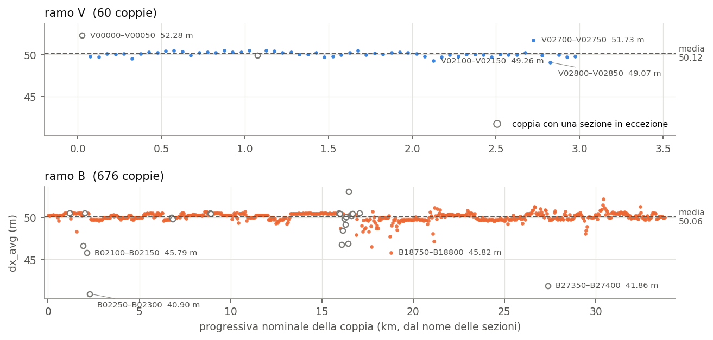
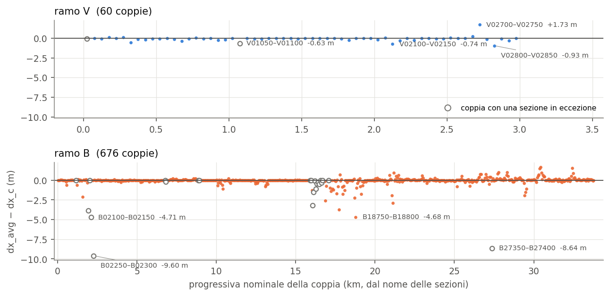
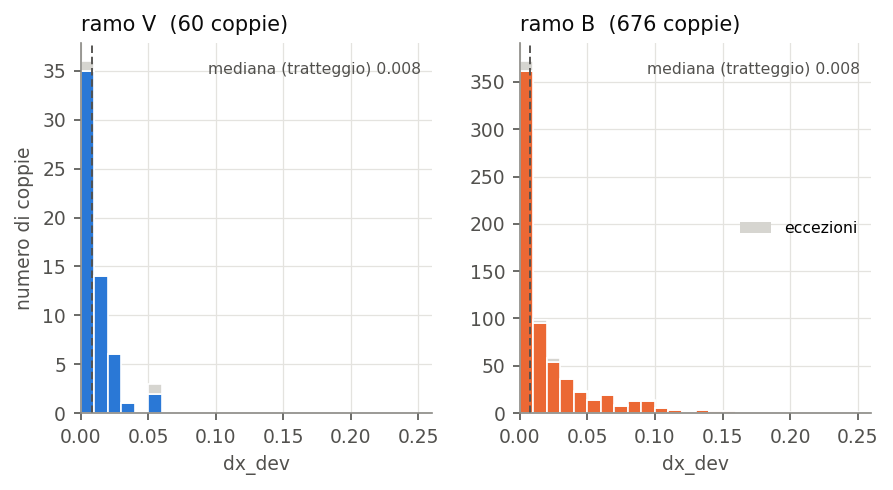
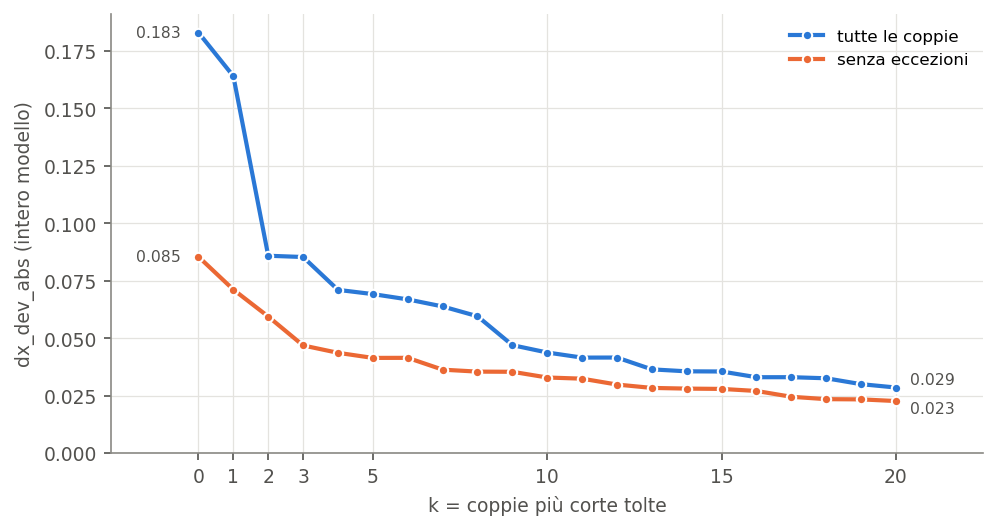

# Analisi statistica del passo tra le sezioni (sezioni a 50 m)

Analisi delle sezioni attuali, in due rami: **V** (V00000–V03000, Brenta vecchio) e **B** (B00000–B33800, da Caldonazzo a valle). Stato del 24 novembre 2026, sera: dopo le ultime modifiche a mano (B00150, B01150, B01900, B02000) e con le eccezioni accettate dall'utente (backup `20261124i`). Il contesto è nel [registro di lavoro](workflow.md) e nelle [regole e metodo](Brenta_regole_e_metodo.md).

* **Script:** `scripts/dx_dev.py` per le tabelle ([scheda](scripts/dx_dev.md)) e `scripts/dx_dev_fig.py` per le figure ([scheda](scripts/dx_dev_fig.md)). Rami ed eccezioni vengono letti dalla configurazione [rcs_config_brenta_vb.json](rcs_config_brenta_vb.json).
* **Dati di ogni coppia:** [Brenta_dx_dev_50m.csv](Brenta_dx_dev_50m.csv).
* **Figure:** cartella [figures](figures).

## 1. Oggetto

L'analisi riguarda il passo dx tra sezioni consecutive dello stesso ramo, cioè 736 coppie: 60 nel ramo V e 676 nel ramo B. È svolta su due livelli:

* **Analisi 1, locale:** misura quanto ogni sezione è inclinata rispetto alla successiva (paragrafo 4).
* **Analisi 2, globale:** misura quanto il passo più corto di un ramo, o dell'intero modello, è inferiore al passo medio (paragrafo 5). È questa che conta per un modello 1D: con uno schema esplicito per equazioni iperboliche il passo temporale ammesso dalla condizione CFL, dt ≤ CFL · dx / (|u| + c), lo fissa il dx più piccolo.

Le statistiche sono date due volte:

* **tutte le coppie;**
* **senza eccezioni:** si escludono le coppie che contengono una sezione in eccezione, e le coppie in eccezione per il passo.

Le eccezioni sono quelle accettate dall'utente il 24 novembre 2026 (regole e metodo, §14 bis):
* **sezioni** (escludono le due coppie che toccano): B16100 (3 vertici); B15950, B16250, B16450, B16600, B16650 (vertice vicino su una linea bloccata dei muri di Borgo); B06800, B08900 (regola dei nodi vicini);
* **coppie di passo:** V00000–V00050, V01050–V01100, B01150–B01200, B01900–B01950, B02000–B02050, B02100–B02150, B02250–B02300, B15900–B15950, B15950–B16000, B16050–B16100, B16300–B16350, B16400–B16450, B16450–B16500, B16600–B16650, B17050–B17100, B27350–B27400.

In tutto sono escluse 25 coppie: 2 nel ramo V e 23 nel ramo B.

Nelle figure le coppie in eccezione sono disegnate con un cerchio vuoto grigio.

## 2. Grandezze per coppia

Per la coppia i, formata dalle sezioni k e k+1, si calcolano le grandezze della tabella 1. La figura 1a le mostra su una coppia di esempio.

**Tabella 1.** Grandezze calcolate per ogni coppia di sezioni consecutive; sono le colonne del CSV.

| Simbolo | Colonna del CSV | Significato |
|---|---|---|
| dx_avg,i | `dx_avg` | distanza media tra le due sezioni. Ognuna si campiona in 201 punti equidistanti, per ogni punto si misura la distanza dall'altra sezione, e si fa la media sui punti di entrambe |
| dx_c,i | `dx_c` | distanza lungo la linea d'asse (`dist_next`) |
| dx_avg,i − dx_c,i | `diff_avg_c` | differenza tra le due misure del passo |
| dx_min,i | `dx_min` | distanza minima tra le due sezioni |
| dx_max,i | `dx_max` | distanza massima tra i punti campionati |
| dx_dev,i | `dx_dev` | (dx_avg,i − dx_min,i) / dx_avg,i, analisi 1 |
| angolo | `ang_gradi` | angolo tra le due sezioni, in gradi, misurato sulle corde (primo e ultimo vertice) |
| larghezza | `larg_m` | lunghezza media delle due sezioni |
| e_i | `e_avg_ramo` | (dx_avg,i − media del ramo) / media del ramo |

Una sezione con più di due vertici, come la B16100, è trattata come spezzata: le distanze si misurano su tutta la linea.


*Figura 1. Schema delle due analisi, su una geometria di esempio (non sono sezioni del modello); i valori sono calcolati con lo stesso metodo dello script. (a) Analisi 1: due sezioni consecutive inclinate tra loro. In azzurro una parte delle distanze campionate, la cui media è dx_avg; in arancione dx_min, in viola dx_max. dx_c è misurato lungo la linea d'asse tratteggiata, tra i due punti neri. (b) Analisi 2: un tratto con una curva e una sezione ogni 50 m lungo la linea d'asse. Sotto, la serie dei dx_avg,i: il minimo (in arancione) cade nella curva e fissa il dt; dx_dev_abs confronta il minimo con la media della serie.*

## 3. Il passo lungo i rami

La figura 2 mostra dx_avg di ogni coppia lungo i due rami, la figura 3 la differenza dx_avg − dx_c. Sull'asse orizzontale c'è la progressiva nominale, ricavata dal nome delle sezioni (numero della sezione in metri).



*Figura 2. dx_avg di ogni coppia lungo i rami V e B, con la media del ramo (tratteggio). Sono indicate le coppie più lontane dalla media.*



*Figura 3. dx_avg − dx_c di ogni coppia lungo i rami. Valori negativi: la distanza media tra le due sezioni è più corta del passo lungo la linea d'asse.*


*Figura 4. dx_avg − dx_c in funzione dell'angolo tra le due sezioni, per ramo. Sono indicate le cinque coppie con la differenza più negativa.*

**Tabella 2.** Statistiche di dx_avg − dx_c (m) per ramo, su tutte le coppie.

| Insieme | Coppie | Media | Media dei valori assoluti | Min | Max | \|dx_avg − dx_c\| < 0.1 m | \|dx_avg − dx_c\| < 0.5 m | < −1 m | > +1 m |
|---|---|---|---|---|---|---|---|---|---|
| V | 60 | −0.060 | 0.141 | −0.93 | +1.73 | 68.3% | 91.7% | 0 | 1 |
| B | 676 | −0.087 | 0.211 | −9.60 | +1.69 | 71.0% | 89.9% | 26 | 5 |
| **Totale** | 736 | −0.085 | 0.205 | −9.60 | +1.73 | 70.8% | 90.1% | 26 | 6 |

**Come leggere il paragrafo 3**

* **Le due misure coincidono quasi sempre.** dx_avg e dx_c differiscono in media di 0.20 m in valore assoluto, e per il 90% delle coppie di meno di 0.5 m (tabella 2).
* **Dove divergono.** Gli scarti grandi sono quasi tutti negativi e nascono nelle curve strette (figura 4): la correlazione tra la differenza e l'angolo è −0.71. Sotto i 10° di angolo, cioè nel 90% delle coppie, lo scarto non supera 1.95 m; per le 17 coppie sopra i 20° la mediana è −2.23 m.
* **Casi estremi.** Il minimo è **B02250–B02300 (−9.60 m)**, in una curva di quasi 90° del canale stretto a monte (sezioni larghe 6–16 m, angolo tra le due 83°). Seguono B27350–B27400 (−8.64 m), B18750–B18800 (−4.68 m) e B01900–B01950 (−3.87 m). Senza eccezioni il minimo è B18750–B18800. Gli scarti positivi sono più piccoli, fino a +1.73 m (V02700–V02750); nel ramo B compaiono soprattutto tra sezioni larghe con un angolo moderato (tabella 4).
* **Ramo B.** È il meno regolare (figure 2 e 3). Le zone più disturbate sono attorno a 2 km (B01900–B02300), a Borgo (16–17 km), a 17–19 km, a 21 km e a 27 km.

## 4. Analisi 1: inclinazione tra sezioni consecutive

**dx_dev,i = (dx_avg,i − dx_min,i) / dx_avg,i**

Vale 0 per due sezioni parallele e cresce quando convergono da un lato (figura 1a).

**Tabella 3.** Statistiche di dx_dev per ramo e in totale, con tutte le coppie e senza eccezioni. Le colonne "> 0.01" … "> 0.10" contano le coppie sopra la soglia; angolo e larghezza sono medie sull'insieme.

| Insieme | Coppie | Media | Mediana | Dev. std | 90° perc. | 95° perc. | 99° perc. | Max | > 0.01 | > 0.02 | > 0.05 | > 0.10 | Angolo medio (°) | Larghezza media (m) |
|---|---|---|---|---|---|---|---|---|---|---|---|---|---|---|
| V, tutte | 60 | 0.0120 | 0.0083 | 0.0125 | 0.0266 | 0.0338 | 0.0547 | 0.0580 | 24 | 10 | 3 | 0 | 3.74 | 19.8 |
| B, tutte | 676 | 0.0206 | 0.0076 | 0.0315 | 0.0645 | 0.0899 | 0.1428 | 0.2482 | 303 | 206 | 89 | 20 | 3.74 | 35.0 |
| **Totale, tutte** | 736 | 0.0199 | 0.0076 | 0.0305 | 0.0613 | 0.0865 | 0.1411 | 0.2482 | 327 | 216 | 92 | 20 | 3.74 | 33.8 |
| V, senza eccezioni | 58 | 0.0114 | 0.0083 | 0.0116 | 0.0260 | 0.0294 | 0.0548 | 0.0580 | 23 | 9 | 2 | 0 | 3.58 | 19.7 |
| B, senza eccezioni | 653 | 0.0201 | 0.0075 | 0.0297 | 0.0633 | 0.0880 | 0.1385 | 0.1804 | 291 | 197 | 85 | 18 | 3.40 | 35.5 |
| **Totale, senza eccezioni** | 711 | 0.0194 | 0.0076 | 0.0288 | 0.0599 | 0.0840 | 0.1373 | 0.1804 | 314 | 206 | 87 | 18 | 3.41 | 34.2 |

**Tabella 4.** Le 15 coppie con dx_dev più alto, su tutte le coppie. Le distanze sono in metri; dx_avg − dx_c è la differenza della tabella 2.

| Coppia | dx_c (m) | dx_avg (m) | dx_avg − dx_c (m) | dx_min (m) | dx_max (m) | dx_dev | Angolo (°) | Larghezza (m) | Eccezione |
|---|---|---|---|---|---|---|---|---|---|
| B27350–B27400 | 50.50 | 41.86 | −8.64 | 31.47 | 57.18 | 0.2482 | 42.9 | 36.1 | sì |
| B01900–B01950 | 50.51 | 46.64 | −3.87 | 37.46 | 64.29 | 0.1968 | 50.7 | 32.3 | sì |
| B27750–B27800 | 49.75 | 50.79 | +1.04 | 41.63 | 61.04 | 0.1804 | 9.6 | 111.7 | |
| B32400–B32450 | 49.75 | 51.33 | +1.58 | 42.62 | 63.72 | 0.1697 | 15.6 | 67.7 | |
| B21100–B21150 | 50.00 | 47.14 | −2.86 | 39.61 | 60.03 | 0.1596 | 26.1 | 57.0 | |
| B21450–B21500 | 50.25 | 50.93 | +0.68 | 42.98 | 59.74 | 0.1560 | 14.0 | 68.8 | |
| B32450–B32500 | 49.75 | 50.61 | +0.86 | 43.29 | 58.58 | 0.1446 | 15.0 | 59.9 | |
| B27200–B27250 | 50.50 | 50.91 | +0.41 | 43.67 | 59.93 | 0.1422 | 23.6 | 41.5 | |
| B18750–B18800 | 50.50 | 45.82 | −4.68 | 39.45 | 53.95 | 0.1390 | 35.4 | 27.3 | |
| B28300–B28350 | 49.75 | 50.75 | +1.00 | 43.75 | 58.01 | 0.1380 | 6.3 | 131.6 | |
| B27150–B27200 | 50.50 | 50.01 | −0.49 | 43.47 | 57.27 | 0.1308 | 19.9 | 42.0 | |
| B30150–B30200 | 50.50 | 50.25 | −0.25 | 44.08 | 58.07 | 0.1228 | 28.0 | 32.0 | |
| B17700–B17750 | 50.25 | 46.54 | −3.71 | 41.16 | 55.76 | 0.1157 | 32.2 | 37.9 | |
| B21050–B21100 | 50.00 | 48.05 | −1.95 | 42.58 | 54.94 | 0.1138 | 19.3 | 38.3 | |
| B28250–B28300 | 49.75 | 50.42 | +0.67 | 44.86 | 56.46 | 0.1102 | 5.1 | 135.3 | |



*Figura 5. Istogramma di dx_dev per ramo (classi di 0.01), con le coppie in eccezione in grigio sopra le altre e la mediana tratteggiata. Le scale verticali sono diverse da ramo a ramo.*


*Figura 6. dx_dev in funzione di larghezza · tan(angolo) / dx_avg, la grandezza geometrica che lo spiega quasi del tutto.*

**Come leggere l'analisi 1**

* **Sezioni quasi parallele.** In mediana dx_dev vale 0.8%, circa 0.4 m su 50 m. Nel 90% delle coppie resta sotto il 6.1%, e solo 20 coppie su 736 superano il 10% (tabella 3, figura 5).
* **Peso delle eccezioni.** Toglierle cambia poco la media (da 0.0199 a 0.0194) ma abbassa il massimo da 0.248 a 0.180: le due curve strette B27350–B27400 e B01900–B01950 sono in eccezione. A Borgo i valori sono bassi (0.0001–0.049), perché lì il letto è stretto.
* **Ramo B.** Ha valori in media 1.7 volte quelli del ramo V. Gli angoli medi sono uguali (3.7°), ma le sezioni del ramo B sono larghe in media 35 m, contro 20, e arrivano a 178 m.
* **Geometria.** dx_dev cresce come larghezza · tan(angolo) / dx_avg. La correlazione con questa grandezza è 0.75 su tutte le coppie (figura 6). Il valore è abbassato da un solo punto, B02250–B02300: con un angolo di 83° la tangente è enorme ma la sezione è larga solo 6–16 m. Senza quella coppia la correlazione è 0.96, e la correlazione per ranghi (Spearman) è 0.99. Con il solo angolo la correlazione è 0.76, con la sola larghezza 0.43.
* **Due tipi di casi.** I valori alti nascono o da un angolo grande (B27350–B27400: 43°, B01900–B01950: 51°, entrambe in eccezione) o da una sezione molto larga con un angolo piccolo (B28300–B28350: 6° su 132 m). Solo i primi accorciano davvero il passo. Nella tabella 4 le coppie con angolo sopra i 25° hanno tutte dx_avg − dx_c negativo, da −0.25 a −8.64 m. Quelle larghe almeno 60 m con angolo sotto i 16° hanno invece differenze positive, da +0.67 a +1.58 m.

## 5. Analisi 2: passo minimo rispetto al passo medio

Partendo dalla serie dei dx_avg,i di un insieme di coppie (un ramo, o tutto il modello):

**dx_dev_abs = (media dx_avg − min dx_avg) / media dx_avg**

È positivo o nullo (figura 1b). 1 − dx_dev_abs = min/media è, a parità di velocità, il rapporto tra il dt imposto dalla CFL con il passo più corto e quello che si avrebbe con il passo medio. La stessa grandezza è calcolata anche sulla serie dei dx_c (passo lungo la linea d'asse) e su quella dei dx_min (caso peggiore, il punto in cui due sezioni si avvicinano di più).

**Tabella 5.** dx_avg e dx_dev_abs per ramo e in totale, con tutte le coppie e senza eccezioni. Le ultime due colonne danno dx_dev_abs calcolato sulla serie dei dx_c e su quella dei dx_min invece che su quella dei dx_avg.

| Insieme | Coppie | Media dx_avg (m) | Dev. std (m) | Min dx_avg (m) | Coppia del min | Max dx_avg (m) | dx_dev_abs | min/media | dx_dev_abs su dx_c | dx_dev_abs su dx_min |
|---|---|---|---|---|---|---|---|---|---|---|
| V, tutte | 60 | 50.12 | 0.46 | 49.07 | V02800–V02850 | 52.28 | 0.0210 | 0.979 | 0.0085 | 0.0610 |
| B, tutte | 676 | 50.06 | 0.76 | 40.90 | B02250–B02300 | 53.12 | 0.1829 | 0.817 | 0.0599 | 0.3582 |
| **Totale, tutte** | 736 | 50.07 | 0.74 | 40.90 | B02250–B02300 | 53.12 | **0.1830** | 0.817 | 0.0599 | 0.3587 |
| V, senza eccezioni | 58 | 50.08 | 0.37 | 49.07 | V02800–V02850 | 51.73 | 0.0203 | 0.980 | 0.0076 | 0.0609 |
| B, senza eccezioni | 653 | 50.10 | 0.52 | 45.82 | B18750–B18800 | 52.19 | 0.0855 | 0.915 | 0.0081 | 0.1965 |
| **Totale, senza eccezioni** | 711 | 50.10 | 0.51 | 45.82 | B18750–B18800 | 52.19 | **0.0854** | 0.915 | 0.0081 | 0.1970 |

**Tabella 6.** Percentili dello scarto di ogni coppia dalla media del suo insieme, e_i = (dx_avg,i − media) / media, e numero di coppie sotto −2%, −5% e −10%. Lo scarto è con segno: negativo per le coppie più corte della media.

| Insieme | 1° perc. | 5° perc. | 10° perc. | Mediana | 90° perc. | 95° perc. | 99° perc. | e < −0.02 | e < −0.05 | e < −0.10 |
|---|---|---|---|---|---|---|---|---|---|---|
| V, tutte | −0.0187 | −0.0087 | −0.0082 | −0.0010 | 0.0075 | 0.0077 | 0.0367 | 1 | 0 | 0 |
| B, tutte | −0.0636 | −0.0160 | −0.0075 | 0.0027 | 0.0093 | 0.0112 | 0.0227 | 30 | 9 | 2 |
| **Totale, tutte** | −0.0614 | −0.0155 | −0.0073 | 0.0024 | 0.0091 | 0.0110 | 0.0235 | 30 | 9 | 2 |
| V, senza eccezioni | −0.0181 | −0.0085 | −0.0075 | −0.0003 | 0.0074 | 0.0083 | 0.0190 | 1 | 0 | 0 |
| B, senza eccezioni | −0.0383 | −0.0141 | −0.0077 | 0.0019 | 0.0084 | 0.0104 | 0.0202 | 23 | 3 | 0 |
| **Totale, senza eccezioni** | −0.0357 | −0.0131 | −0.0076 | 0.0017 | 0.0084 | 0.0102 | 0.0215 | 24 | 3 | 0 |


*Figura 7. dx_avg di tutte le 736 coppie in ordine crescente, con la media dell'intero modello. Le poche coppie all'estrema sinistra fissano il dt; il resto della curva è quasi piatto attorno ai 50 m.*

**Tabella 7.** Sensibilità: dx_dev_abs dell'intero modello dopo aver tolto le k coppie con dx_avg più corto.

| Insieme | k = 0 | k = 1 | k = 2 | k = 3 | k = 5 | k = 10 |
|---|---|---|---|---|---|---|
| **Totale, tutte** | 0.1830 | 0.1640 | 0.0859 | 0.0853 | 0.0692 | 0.0438 |
| **Totale, senza eccezioni** | 0.0854 | 0.0711 | 0.0594 | 0.0468 | 0.0414 | 0.0329 |



*Figura 8. La sensibilità della tabella 7, estesa a k = 20.*

**Tabella 8.** Le 15 coppie con dx_avg più corto, cioè quelle che fissano il dt. e è lo scarto dalla media dell'intero modello, 50.07 m.

| Coppia | dx_avg (m) | e | dx_c (m) | dx_min (m) | dx_dev | Angolo (°) | Eccezione |
|---|---|---|---|---|---|---|---|
| B02250–B02300 | 40.90 | −0.1830 | 50.50 | 36.98 | 0.0958 | 83.3 | sì |
| B27350–B27400 | 41.86 | −0.1638 | 50.50 | 31.47 | 0.2482 | 42.9 | sì |
| B02100–B02150 | 45.79 | −0.0854 | 50.50 | 42.32 | 0.0758 | 43.4 | sì |
| B18750–B18800 | 45.82 | −0.0848 | 50.50 | 39.45 | 0.1390 | 35.4 | |
| B17700–B17750 | 46.54 | −0.0704 | 50.25 | 41.16 | 0.1157 | 32.2 | |
| B01900–B01950 | 46.64 | −0.0684 | 50.51 | 37.46 | 0.1968 | 50.7 | sì |
| B16050–B16100 | 46.76 | −0.0660 | 49.98 | 44.71 | 0.0438 | 12.0 | sì |
| B16400–B16450 | 46.92 | −0.0629 | 47.14 | 46.56 | 0.0077 | 3.1 | sì |
| B21100–B21150 | 47.14 | −0.0585 | 50.00 | 39.61 | 0.1596 | 26.1 | |
| B18700–B18750 | 47.77 | −0.0459 | 50.00 | 43.36 | 0.0922 | 20.9 | |
| B16850–B16900 | 47.93 | −0.0426 | 50.50 | 42.81 | 0.1069 | 24.5 | |
| B21050–B21100 | 48.05 | −0.0403 | 50.00 | 42.58 | 0.1138 | 19.3 | |
| B29400–B29450 | 48.05 | −0.0403 | 50.00 | 44.41 | 0.0757 | 7.4 | |
| B17550–B17600 | 48.31 | −0.0351 | 50.00 | 43.50 | 0.0996 | 22.2 | |
| B17200–B17250 | 48.35 | −0.0342 | 49.75 | 44.46 | 0.0806 | 17.0 | |

**Altri dati**

* **dx_min più corti:** B27350–B27400 31.47 m, B02250–B02300 36.98, B01900–B01950 37.46, B18750–B18800 39.45, B21100–B21150 39.61, B17700–B17750 41.16, B27750–B27800 41.63, B02100–B02150 42.32, B21050–B21100 42.58, B32400–B32450 42.62.
* **dx_avg più lunghi:** B16450–B16500 53.12 m, V00000–V00050 52.28, B30400–B30450 52.19, V02700–V02750 51.73, B30350–B30400 51.51, B32400–B32450 51.33, B26600–B26650 51.28, B26650–B26700 51.26, B30450–B30500 51.21, B21150–B21200 51.19.

**Come leggere l'analisi 2**

* **Passo molto uniforme.** Il passo medio è 50.07 m con una deviazione standard di 0.74 m; senza eccezioni 50.10 m e 0.51 m. L'80% delle coppie sta tra −0.7% e +0.9% dalla media (10° e 90° percentile, tabella 6), e la curva dei passi ordinati è quasi piatta (figura 7).
* **Con tutte le coppie, due casi fissano il dt.** dx_dev_abs sull'intero modello vale 0.183: il passo minimo, B02250–B02300, è il 18% più corto della media. Togliendo quella coppia scende a 0.164 (B27350–B27400), togliendo anche questa a 0.086 (tabella 7, figura 8). Entrambe sono curve strette accettate come eccezioni.
* **Senza eccezioni.** dx_dev_abs scende a 0.085: il passo minimo è B18750–B18800 (45.82 m, angolo 35°), seguito da B17700–B17750 (46.54 m) e B21100–B21150 (47.14 m). Il dt ammesso dalla CFL è il 91.5% di quello che si avrebbe con il passo medio, contro l'82% con tutte le coppie (tabella 5). Togliendo altre 10 coppie si arriva a 0.033, e a k = 20 a 0.023.
* **Le curve a monte, dopo l'unione dei rami.** B02100–B02150 e B02250–B02300 (ex N02150–N02200 e N02300–N02350) sono nel tratto in cui le sezioni del vecchio ramo N sono state spostate di 27.23 m verso monte, e sono finite in una curva di quasi 90°. Sono accettate come eccezioni.
* **Effetto delle curve.** Lungo la linea d'asse il passo è quasi costante: senza eccezioni dx_dev_abs su dx_c vale 0.008. Il passo si accorcia davvero solo dove le sezioni si inclinano l'una rispetto all'altra, nelle curve (paragrafo 3). I casi peggiori dell'analisi 2 sono infatti anche ai primi posti dell'analisi 1, i primi cinque con angoli di 32–83° (tabella 8).
* **Misura alternativa.** Se il passo fosse misurato con dx_min invece che con dx_avg, il caso peggiore sarebbe molto più severo: dx_dev_abs 0.36 con tutte le coppie e 0.20 senza eccezioni.
* **Rami.** Il ramo V è il più regolare (0.020 senza eccezioni). Nel ramo B il caso peggiore senza eccezioni è B18750–B18800 (0.086).

## 6. Riproduzione

```bash
~/anaconda3/bin/python3 scripts/dx_dev.py layers docs/Brenta_dx_dev_50m.csv docs/rcs_config_brenta_vb.json
```

```bash
~/anaconda3/bin/python3 scripts/dx_dev_fig.py docs/Brenta_dx_dev_50m.csv docs/figures
```

Il primo comando rigenera il CSV e stampa le tabelle 3–8; le tabelle 1 e 2 e i commenti sono scritti a mano. Il secondo rigenera le figure. Entrambi vanno lanciati dalla cartella del progetto e leggono soltanto i layer.

Lo script generalizzato (rami ed eccezioni dalla configurazione) è stato confrontato con la versione precedente sui layer di prima dell'unione: tutte le grandezze di tutte le 732 coppie di allora sono identiche. Cambia solo la regola di esclusione: un'eccezione di passo esclude la sola coppia, non anche le coppie vicine.
